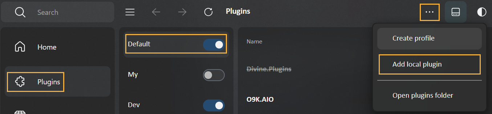
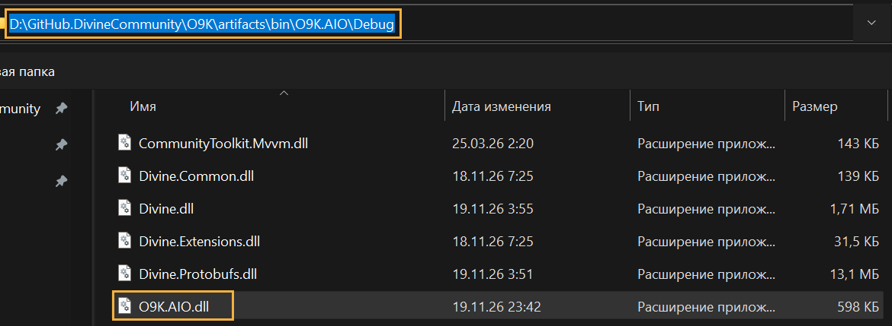

# Getting Started

## Local plugins

If you already have a built plugin DLL, you can add it directly in the Divine desktop client. This guide uses `O9K.AIO.dll` as an example.

### 1. Choose a plugin profile

Open **Divine** and select **Plugins** in the left sidebar. Click the name of the profile where you want to add the plugin, such as **Default**. The right pane shows the plugins in that profile.

In the top bar, click **⋯** and choose **Add local plugin**.



### 2. Select the plugin DLL

In the file picker, browse to the output folder, select **O9K.AIO.dll**, and click **Open**. You can also paste the full path into the **File name** field. Here is an example path to the Debug build.

```text
D:\GitHub.DivineCommunity\O9K\artifacts\bin\O9K.AIO\Debug\O9K.AIO.dll
```



If your checkout is elsewhere or you built a different configuration, use the path to your own build. If the file is missing, build the plugin first and then select the DLL from the build output.

### 3. Check that the plugin is enabled

Look for the **O9K.AIO** row that shows **Local plugin** in the **Author** column. Check that the profile switch on the left and the switch at the far right of the local plugin row are both on. If you also have the store version, its name may appear crossed out while the local build is active.

If you cannot find the local row, check that you are viewing the profile you selected before opening the file picker.


### 4. Load an updated build

If you rebuild the plugin, leave the updated DLL at the same path so Divine can find it. When Divine is already running in the game, return to the game and press **F5** to reload local plugins if you use the default reload key. If the new build is in a different folder, add that DLL from the client and check which build is enabled in your profile.

## Build a plugin from source

1. Install the [.NET 11 SDK](https://dotnet.microsoft.com/download/dotnet/11.0) and an IDE. Use [Visual Studio](https://visualstudio.microsoft.com/downloads/) with a .NET development workload or [JetBrains Rider](https://www.jetbrains.com/rider/download/).
2. Clone [DivinePlugins/Samples](https://github.com/DivinePlugins/Samples) and open the solution or project. Use the sample's `global.json` to select the .NET SDK and pin the `Divine.Sdk` version. The plugin project declares `<Project Sdk="Divine.Sdk" />`.
3. Build the project in your IDE and add its output DLL using the steps above. You can also select the plugin's `.csproj` in **Add local plugin** and let Divine build the project for you.
